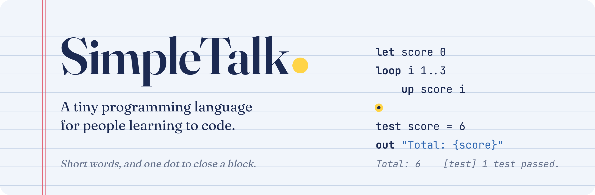

<p align="center">
  
</p>

<p align="center">
  <a href="https://github.com/bicky21/SimpleTalk/actions/workflows/tests.yml"></a>
  
  
  
</p>

<p align="center">
  <a href="https://bicky21.github.io/SimpleTalk/"><b>Try it in your browser</b></a> ·
  <a href="https://bicky21.github.io/SimpleTalk/manual/"><b>Manual</b></a> ·
  <a href="#quick-start">Quick start</a> ·
  <a href="#what-makes-simpletalk-different">What's different</a> ·
  <a href="#the-language-in-one-minute">The language</a> ·
  <a href="#advanced-features-on-modest-hardware">Advanced features</a> ·
  <a href="docs/LANGUAGE.md">Full guide</a> ·
  <a href="examples">Examples</a>
</p>

---

<p align="center"><i>Developed by <b>Bicky Prasad Yadav</b> and <b>Claude</b></i></p>

SimpleTalk is a small programming language for people writing their first programs. Every keyword is **2–5 letters**, every block closes with **a single dot**, and when something goes wrong it shows **where, why, and how to fix it**. It still grows with you: maps, pipelines, pattern matching, error handling, modules, files, JSON and concurrent tasks are all built in. It runs on plain Python with nothing else to install, in about 17 MB of memory.

```
fn square n
    ret n * n
.

test square(4) = 16

loop i 1..5
    out "{i} squared is {square(i)}"
.
```

## Quick start

**Learn it:** the [SimpleTalk Manual](https://bicky21.github.io/SimpleTalk/manual/) goes from your first line to tasks and modules, with a **Try it** button on every example. You can also [read it on GitHub](docs/manual/00-index.md).

**No install:** open the [online playground](https://bicky21.github.io/SimpleTalk/). It runs the real SimpleTalk engine in your browser, with every example, Explain, and shareable links.

**On your computer:**

```bash
git clone https://github.com/bicky21/SimpleTalk.git
cd SimpleTalk
python3 -m venv .venv && source .venv/bin/activate
pip install -e .

simpletalk examples/01_hello.simp      # run a program
simpletalk                             # interactive mode
```

On Windows, activate the environment with `.venv\Scripts\activate`. To skip installing, run `python3 -m simpletalk <file>` from the project folder.

**In VS Code:** install the extension from [`editors/vscode/simpletalk-2.3.1.vsix`](editors/vscode) (Extensions view → `...` → *Install from VSIX...*). Press **F5** or the ▶ button to run a program, use 📖 to explain it, and mistakes are underlined in red when you save. It also adds highlighting, snippets (type `loop` + Tab) and auto-indent.

## What makes SimpleTalk different

Most languages leave learning tools to separate programs: debuggers, test frameworks, linters. SimpleTalk builds them into the language, so they work from the very first line, with no setup and nothing new to learn.

### 1. It explains your code back to you

`--explain` reads a program and describes every line in plain English, without running it. Use it to check a program says what you meant.

```text
$ simpletalk --explain examples/03_decisions.simp
What examples/03_decisions.simp does:

   2  Store 72 in marks.
   4  If marks is at least 90:
   5      Show "Grade A"
      Otherwise, if marks is at least 70:
   7      Show "Grade B"
      Otherwise, if marks is at least 50:
   9      Show "Grade C"
      Otherwise:
  11      Show "Try again next time"
  14  If marks is greater than 40 and marks is not equal to 100:
  15      Show "You passed, and there is still room to grow."
```

### 2. Variables can report their own changes

`watch` tells you every time a variable changes, along with the line that changed it and the old value. You don't need to scatter print statements around.

```
let score 0
watch score
loop round 1..3
    up score round * 10
.
```
```text
[watch] line 2: watching score, now 0
[watch] line 4: score = 10  (was 0)
[watch] line 4: score = 30  (was 10)
[watch] line 4: score = 60  (was 30)
```

### 3. Tests are part of the language

Write `test` next to your code. When a test fails, it shows both sides, so you see the actual value straight away.

```
fn square n
    ret n * 2          ;; a bug
.
test square(3) = 9
```
```text
Oops! Something went wrong while running on line 4:

    4 | test square(3) = 9
        ^

  Test failed: square(3) = 9
  Hint: The left side is 6 and the right side is 9.
```

When every test passes, you get a one-line summary: `[test] 3 tests passed.`

### 4. Input that checks itself

`in age num` keeps asking until a number is typed, and `in ok yes` until the answer is yes or no (stored as `true` or `false`). That removes a whole class of beginner crashes.

```
in age num "How old are you?"
in likes yes "Do you like coding?"
```
```text
How old are you? twenty
Please type a number.
How old are you? 20
Do you like coding? maybe
Please answer yes or no.
```

### 5. Step-by-step runs

`--trace` shows each line just before it runs, so you can follow the order your program actually takes through loops and decisions.

```text
$ simpletalk --trace examples/02_variables.simp
  > line 2   | let name "Bicky"
  > line 3   | let age 20
  > line 4   | out "Hi {name}, you are {age} years old."
Hi Bicky, you are 20 years old.
```

### 6. Errors that teach

Every error points at the exact spot and suggests a fix. It catches spelling slips, and if you type a word from Python or another language, it tells you the SimpleTalk word to use instead.

```text
    2 | out "Hi {nmae}"
                 ^
  I don't know what 'nmae' is.
  Hint: Did you mean 'name'?
```
```text
    1 | print "hi"
        ^
  SimpleTalk doesn't use 'print'. The word for that is 'out'.
```

## The language in one minute

| To…                       | Write                                      |
|---------------------------|--------------------------------------------|
| Show something            | `out "Hello"`                              |
| Store a value             | `let age 12`                               |
| Add to a number           | `up age` adds 1, `up age 5` adds 5         |
| Ask the user              | `in name "Your name?"`                     |
| Decide                    | `when age > 10` … `else when` … `else` … `.` |
| Repeat                    | `loop 3` … `.`                             |
| Count                     | `loop i 1..10` … `.` (`10..1` counts down) |
| Go through a list         | `loop x my_list` … `.`                     |
| Repeat while              | `loop while x < 10` … `.`                  |
| Make a list               | `let fruits ["apple", "mango"]`            |
| Change a list             | `add fruits "kiwi"`, `del fruits "kiwi"`   |
| Check a list              | `fruits has "kiwi"`                        |
| Make a function           | `fn greet name` … `ret` … `.`              |
| Watch a variable          | `watch score`                              |
| Check your code           | `test score = 10`                          |
| Store named values        | `let me {name: "Bicky"}` then `me.name`  |
| Comment                   | `;; a note`                                |

That's nearly the whole language. The [full guide](docs/LANGUAGE.md) covers every keyword and built-in function, and includes a table for moving over from Python.

## Examples

| Program | Shows |
|---|---|
| [01_hello](examples/01_hello.simp) | Your first line |
| [02_variables](examples/02_variables.simp) | `let`, `up`, text with `{values}` |
| [03_decisions](examples/03_decisions.simp) | `when` / `else when` / `else` |
| [04_loops](examples/04_loops.simp) | Counting, ranges, `loop while`, `skip` |
| [05_lists](examples/05_lists.simp) | `add`, `del`, positions, `has` |
| [06_functions](examples/06_functions.simp) | `fn`, `ret`, recursion |
| [07_guess_the_number](examples/07_guess_the_number.simp) | A complete little game |
| [08_fizzbuzz](examples/08_fizzbuzz.simp) | The classic exercise |
| [09_superpowers](examples/09_superpowers.simp) | `watch`, `test` and smart input |
| [10_records](examples/10_records.simp) | Maps and `pick` |
| [11_errors](examples/11_errors.simp) | `try`, `fail` and `oops` |
| [12_pipelines](examples/12_pipelines.simp) | Pipelines and quick functions |
| [13_modules](examples/13_modules.simp) | `use` with a small library |
| [14_files_and_memory](examples/14_files_and_memory.simp) | Files, JSON and `keep` |
| [15_tasks](examples/15_tasks.simp) | Tasks running side by side |

## Advanced features on modest hardware

The features people usually reach for a "serious" language to get are all part of SimpleTalk, with the same short words. The whole interpreter is pure Python with no dependencies. "Hello, World!" starts in well under a tenth of a second and peaks around 17 MB of memory, so an old laptop or a Raspberry Pi is plenty.

Programs are compiled into ready-to-run Python functions before they start, which made SimpleTalk 4–5× faster in version 2.3 without changing a single error message:

| Benchmark (2-core laptop) | 2.2 | 2.3 |
|---|---|---|
| [Add up 1 to 1,000,000](benchmarks/count_million.simp) | 1.6 s | 0.34 s |
| [Loops, recursion, lists, maps, pipelines](benchmarks/mixed.simp) | 1.26 s | 0.29 s |

**Maps**: named values, nested freely with lists.
```
let me {name: "Bicky", skills: ["Python"]}
add me.skills "SimpleTalk"
out "{me.name} knows {len(me.skills)} languages"
```

**Pipelines and quick functions**: transform data step by step, no loops needed.
```
out scores | only it >= 60 | each it * 2 | sort
let double fn n -> n * 2
```

**Pattern matching**: choose by value or range.
```
pick marks
is 90..100
    out "A"
is 75..89
    out "B"
else
    out "Keep going"
.
```

**Error handling**: catch problems, or raise your own.
```
try
    let n num("twenty")
fail why
    out "Couldn't convert:", why
.
oops "Not enough money"
```

**Modules**: split a program across files.
```
use "lib/geometry"
out circle_area(2)
```

**Files and JSON**: one call each.
```
save("profile.json", {name: "Bicky", level: 3})
let profile load("profile.json")
```

**Remembered values**: a value that survives between runs, with no database.
```
keep high_score 0
when score > high_score
    let high_score score
.
```

**Tasks**: do things side by side.
```
task download
    wait(2)
    ret "data"
.
out "Working while it downloads..."
let result await download
```

## Built to be stable

- **No raw Python errors.** Every problem becomes a SimpleTalk message. The interpreter is fuzz-tested with tens of thousands of random programs.
- **Guard rails.** Runaway recursion, endless input and huge ranges all stop with a clear explanation instead of freezing. Deep recursion is safe even on Windows' small default stack, and Ctrl+C stops any program cleanly, including one that is waiting for input or running tasks.
- **Locked-in behaviour.** A test suite covers the language, the examples and the error messages, and runs on Linux and Windows for every push.
- **Compatibility promise.** Within 2.x, working programs keep working. See the [changelog](CHANGELOG.md).

## Use it from Python

```python
from simpletalk import run
run('out "Hello from Python!"')
```

## How it works

```
simpletalk/
  lexer.py        text   → tokens
  parser.py       tokens → syntax tree, with friendly syntax errors
  interpreter.py  runs the tree: maps, pipelines, try, use, keep, tasks, watch, test
  compiler.py     turns the tree into fast Python functions before running
  runner.py       runs programs on a big-stack thread; Ctrl+C and input handling
  explain.py      syntax tree → plain English (--explain)
  builtins.py     len, sort, rand, keys, … (plus read/write/load/save in the interpreter)
  cli.py          the simpletalk command and interactive mode
playground/       the browser playground (Pyodide in a Web Worker)
editors/vscode/   the VS Code extension
```

Contributions are welcome. Run `pip install -e ".[dev]"` and `python -m pytest` before opening a pull request.

## Developers

SimpleTalk is developed by **Bicky Prasad Yadav** ([@bicky21](https://github.com/bicky21)) and **Claude**.
